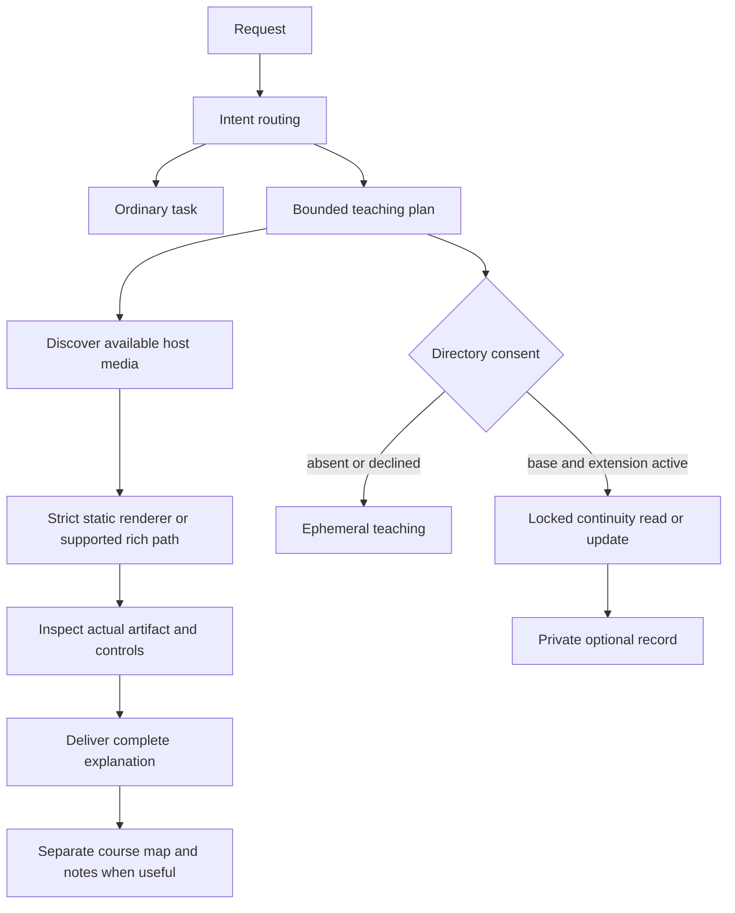
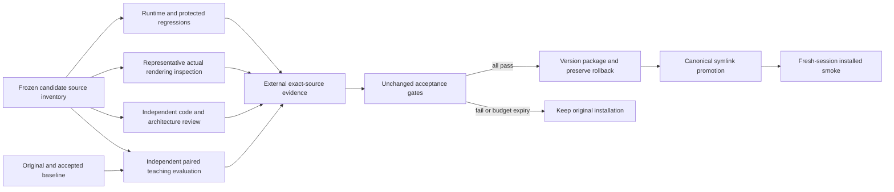

# Engineering review: visual-intuition candidate

Reviewed 2026-10-17 at `fd78ffe`. Scope: read-only product review; this report is the only file written by this reviewer. Verdict: **not ready for acceptance or installation**. The earlier candidate deadline expired; the proposed six-hour budget is still unanswered. This report neither starts a candidate nor changes its gates.

Paths below use `P = skills/teach-pro-max/references/prax-teach-v2/`. Line references are to the inspected source, not generated companions. Read the implementation plan, DESIGN-v1, EVALUATION-CONTRACT-v2, PRODUCT-DIRECTION, IMPLEMENTATION-GAPS, ASKTHEMOVE-AESTHETICS, Task 2 report, Task 1 rereview 2, and the new IMPLEMENTATION-SCOPE. Hidden inputs, grading keys and sealed outputs were not accessed. Shared-store recall supplied a direction lead; conclusions below use repository evidence.

## Findings requiring completion

### 1. Ordinary editing/writing requests still enter teaching (high, reproduced runtime bug)

`P/scripts/praxteach/routing.py:424–467` applies the early ordinary-task guard only when content-task or engineering vocabulary also matches. The late guard comes after brevity/course/lesson matching. Actual probes returned:

| Request | Observed | Required |
|---|---|---|
| Edit this lesson | teach / lesson | ordinary_task / null |
| Delete this course | teach / course / consent_required | ordinary_task / null / false |
| Quickly write a poem | teach / quick | ordinary_task / null |
| Build an interactive lesson | teach / lesson | retain |
| Build a course for beginners | teach / course | retain |
| Fix this Python function | ordinary_task / null | retain |
| Teach me fractions | teach / lesson | retain |

The issue previously reported remains present. Repair intent precedence once: explicit API overrides, then ordinary task intent unless the request actually asks to create teaching material or learn, then teaching brevity/sequence/default decisions. Preserve the public return shape. Do not fix this with three phrase-specific exclusions. Add tests for polite variants, creation versus editing/deletion, technical teaching artifacts and ordinary engineering objects. Also inspect topic/intent ambiguity: `Teach me the meaning of resume` currently becomes course because `COURSE_PATTERNS` matches a noun in the topic (`routing.py:42–51,445–450`). That is a lexical heuristic limit, not consent being granted by the router.

### 2. Rich-route verification rebuilds deployed artifacts during selection (high, source-confirmed runtime defect)

`routing.py:296–311,325–376` invokes the runtime verifier for a recognized packaged lesson. `P/scripts/verify_visual_runtime.py:47–64` runs the build and tests even when `--output` is external. `P/runtime/prax-visual-lab/build.mjs:15–19` deletes and recreates `dist` in place. No timeout is supplied to the router subprocess or the two verifier subprocesses.

Concrete failure: a second route or browser request reads dist while the first route has removed it; another verifier can race that build too. A read-only installed tree also cannot support this selection path reliably. A hanging Node test can hold a teaching route indefinitely. This was established by following the executable call chain; no destructive build/race experiment was run in the shared checkout.

Minimum fix: separate candidate build from verification replay. Build in an isolated staging tree, inspect its exact bytes, and publish only accepted immutable bytes. Route-time checks must be read-only, bounded and fail closed against current bindings; if replay remains required, replay checks of already-built bytes with a deadline. Keep network/source/dist/test/contract binding checks. Do not replace verification with a bare `status=passed` trust check or add a persistent service/cache. Add tests that snapshot path sets, bytes and mtimes before/after routing, run concurrent route readers, deny writes, and simulate verifier timeout.

### 3. Historical receipts are still selected as current evidence (high, release blocker; stale history is not runtime corruption)

`routing.py:19,332–375` selects `evidence/zero-api-visual-runtime/verification.json`. A fresh, nonmutating `runtime_bindings(ROOT)` comparison found exactly one unequal binding: `routing`. Thus an otherwise unchanged packaged runtime loses eligibility because the historical receipt attests to old routing bytes. The equality rejection is correct; editing the old receipt would destroy provenance.

The same architecture affects the release gate:

- `P/scripts/verify.py:292–297` rejects an external full-verification receipt path and `326–330` writes its running receipt inside the package.
- `P/scripts/validate_workspace.py:2439–2500` expects that fixed receipt to bind current durable bytes and the current verifier.
- `P/scripts/build_package.py:274–345` requires immutable Git-blob receipts and a reviewed inventory, but reads the old fixed evidence paths.
- Legacy provenance binds `references/LEGACY-VISUALIZATION-ROUTER.md` to old bytes (`validate_workspace.py:1807–1828`); the old receipt must remain historical even though policy was legitimately revised.
- `P/tests/test_validator_cli.py:230–246` asserts the old release succeeds and hardcodes ten schemas. The additive continuity schema makes that count obsolete; this is not grounds to suppress provenance/security checks.

Minimum complete architecture: one explicit current-evidence selection shared by runtime verification, validator and package builder, pointing to an external versioned evidence directory bound to the exact candidate source inventory. Keep the old in-package evidence untouched and independently inspectable as historical. Reject missing, malformed, wrong-source, wrong-tool and superseded current receipts. Distribution metadata may include receipt hashes/locations outside the source payload it attests to. Do not use current time or newest filename as the selector. Preserve original immutable-blob verification semantics for historical packages.

This is an evidence plumbing repair, not approval to alter evaluator gates. A versioned current receipt format/selection must be agreed in the candidate scope before implementation. Do not convert every historical test into a skipped test. Test historical validity against its frozen original inventory, and current eligibility against newly produced exact-byte evidence. The current candidate remains rejected until those checks pass.

### 4. Requested visual default and separate map/notes are not yet delivered (high, product completeness gap)

`P/scripts/render_markdown.mjs:595–625` currently uses orange/teal accents, sans body text and generic serif headings; it does not implement the requested AskTheMove prose/technical/coach hierarchy. `P/references/ARTIFACT-CONTRACT.md:195–199` has breadcrumbs/a compact map, not the distinct editable course map and reusable notes contract. The research gap report remains accurate for these features.

Minimum change: short normative instructions for warm paper/semantic ink, precise diagrams, short handwritten annotations, meaningful changes, finished-state access, learner overrides and consistent object labels across media. Add reusable local presentation guidance/assets with font fallbacks; exact fonts only with reviewed portable licenses. Course map, teaching stage and notes are separate logical artifacts, linked when useful. A quick answer needs no manufactured course directory. Notes contain definitions, worked reasoning, limits, sources and unresolved learner questions. Save-nothing and state-consent rules still apply.

The static renderer's exclusion of inline SVG/script/style (`render_markdown.mjs:12–39,343–391`) is an intentional safety boundary. It is not an animation bug. Use its accepted static image/Markdown forms and existing rich or host-specific delivery for motion. Do not broaden the sanitizer to make generated JavaScript work. Do not generalize the one packaged floating-point lesson binding (`routing.py:21–26`) into a universal lesson runtime or embed a neural-network-specific generator.

### 5. Actual teaching and delivery acceptance is outstanding (high, evidence gap)

Deterministic policy tests can pass while the ordinary-task probes fail. Likewise CSS, source generation and renderer exit codes cannot prove purposeful visual teaching. EVALUATION-CONTRACT-v2 explicitly separates tool-less teaching comparisons from runtime consent/security and actual rendered inspection. Neither the old runtime receipt nor this review replaces those layers.

After a newly authorized run budget and frozen candidate, independent evaluation must apply the unchanged six-family/three-repetition paired matrix and protected gates, retain all outputs and separately inspect representative rendered artifacts. Public examples may exercise mathematical, physical, historical and language explanations, including static and tool-limited delivery; they are not held-out evidence. Four secondary public host smoke cases remain required when usable, with honest availability limits. Do not run another candidate against exposed hidden cases or install based on source-only scores.

## Continuity: verified strengths and a precise lifecycle limitation

The narrow continuity module is the correct reuse strategy. It has exact-field/bounded validation, independent schema, active base plus extension consent, workspace locking, anchored private single-link state, atomic replacement, and inspect/export/reset paths after withdrawal. It does not modify learning evidence or infer mastery from covered topics. Existing learner schemas, scheduler, journals, event IDs/hashes and generic IO should remain protected.

`continuity.py:141–154,181–197,209–217,257–279` correctly rejects competing writers in the same record lifetime. Tests verify concurrent update exit codes `[0,6]` (`tests/test_continuity_cli.py:163–187`). A full reset deletes the record; regrant starts revision 1. The docs explicitly state that revisions are not generation IDs and clients must discard cached revisions (`references/OPERATIONS.md:189–197`).

A throwaway-workspace probe confirmed: grant rev1 → confirmed full reset → explicit regrant rev1 → old update with expected rev1 succeeds. This is a cross-lifetime stale writer, not failed locking, torn writes, permission bypass or implicit regrant. It requires a new explicit extension grant before the stale content update can succeed. The numeric expected revision alone cannot identify an old lifetime.

For the existing approved contract, document/test the boundary and require the coordinating host to cancel outstanding continuity work on full reset and reread after regrant. Do not claim global stale-write protection. If independent processes must be prevented from crossing resets, that requires a separately authorized generation token or equivalent API/schema design; a hidden tombstone conflicts with the stated full-reset deletion semantics. Do not silently add either during this repair. This limitation does not justify rewriting the existing secure state architecture.

Performance: every continuity operation validates review/event/source evidence through `_validate_workspace_state` (`state.py:1445–1473`), then loads continuity again. That introduces work proportional to evidence size under lock; no latency benchmark was run. The bounded record is small, so do not weaken validation or add a cache without measurement. The repeated runtime rebuild in finding 2 is the immediately actionable performance issue. Keep tool manuals behind progressive disclosure and inspect bounded teaching artifacts rather than loading all production recipes by default.

## Data flow and validation boundaries

## Minimum implementation sequence and proposed exact paths

This is a suggested allowlist for a future authorized candidate, not edits made by this review. Freeze it before source changes. No blanket permission for an entire subtree is implied.

1. Product and style: `skills/teach-pro-max/SKILL.md`; `P/SKILL.md`; `P/references/TEACHING-PROTOCOL.md`, `VISUALIZATION-ROUTER.md`, `ARTIFACT-CONTRACT.md`, `VISUAL-RUNTIME.md`, `MODE-CONTRACT.md`; new `P/references/ASKTHEMOVE-PRESENTATION.md`, `COURSE-MAP-AND-NOTES.md`; new `P/assets/askthemove-teaching.css` only if actually consumed by a supported rich artifact. Regenerate only changed Markdown companions. If changing the common static template, explicitly include `P/scripts/render_markdown.mjs` and `P/tests/render_markdown.test.mjs`; change presentation only, preserve sanitizer/publication checks and version template metadata.
2. Routing: `P/scripts/praxteach/routing.py`; `P/tests/test_visual_intuition_policy_v1.py`, `test_core_cli.py`, `test_visual_routing.py`, `test_zero_api_runtime.py`; `P/fixtures/routing-cases-visual-intuition-v1.json`. Preserve historical fixture bytes and record intentional policy assertion replacements.
3. Current verification selection: `P/scripts/verify_visual_runtime.py`, `verify.py`, `validate_workspace.py`, `build_package.py`, `review_payload.py`; proposed narrow shared `P/scripts/current_evidence.py`; `P/tests/test_validator_cli.py`, `test_build_package.py`, `test_review_payload.py`, `test_review_receipts.py`, `test_release_status_ledger.py`, `test_zero_api_runtime.py`. Only if isolated-build support is necessary, add `P/runtime/prax-visual-lab/build.mjs` and a new focused `P/runtime/prax-visual-lab/tests/build-publication.test.mjs`. Do not change runtime pedagogy as part of that build repair.
4. Lifecycle clarity: `P/references/OPERATIONS.md` and its companion; `P/tests/test_continuity_cli.py` for reset/regrant boundary coverage. No continuity schema/runtime change is required for the currently documented lifetime contract. A stronger generation guarantee needs separate authorization.
5. Release reporting: `P/STATUS.md`, `STATUS.html`, `STATUS.json`; `skills/teach-pro-max/references/ENGINE-MANIFEST.json`; `docs/teach-pro-max/review-2026-10-17/CANDIDATE-RESULTS.md`, `CURRENT-EVIDENCE.md`, `INSTALLATION-ROLLBACK.md`. Actual receipts belong in a named external candidate evidence directory, not under the hash they attest to. No install until acceptance; record existing symlink targets, update canonical source links atomically, verify consumers and fresh sessions, and retain the exact rollback checkout.

Protected paths: all existing `P/evidence/**`, `P/historical/**`, old release archives and receipts; original baseline and installed source; evaluator code/configuration/hidden bank/gates; learner schemas and continuity schema unless separately approved; `P/scripts/praxteach/io.py`, scheduler and existing event/journal machinery; learner directories; unrelated research files and other workers' changes. The suggested evidence reader is plumbing, not permission to change protected acceptance semantics.

## Checks and limits of this review

Executed without product edits:

- Fresh deterministic route probes in the table above.
- Nonmutating comparison of historical runtime receipt bindings with current source: only routing binding differs.
- Throwaway real CLI initialization and continuity API reset/regrant/stale-writer probe described above.
- `PYTHONDONTWRITEBYTECODE=1 .venv/bin/python -m unittest discover -s tests -p 'test_continuity*.py' -q`: **10 passed** in 7.751 seconds.
- `PYTHONDONTWRITEBYTECODE=1 .venv/bin/python -m unittest tests.test_visual_intuition_policy_v1 -q`: **8 passed**.

An initial dotted-module combined invocation ran 14 entries and failed to import `tests.test_continuity_security` because it imports `test_continuity_cli` as a top-level test module. The supported discovery invocation above resolves that test-loader path issue; it is not a continuity runtime failure.

The prior Task 2 full run reported 258 tests with two historical-binding failures. That is retained historical execution evidence, not a full suite rerun by this reviewer. No renderer/browser checks, held-out comparison, full release build, installation or human-learning measurement were performed here. Existing untracked research/report trees were left intact. The package remains unaccepted.
